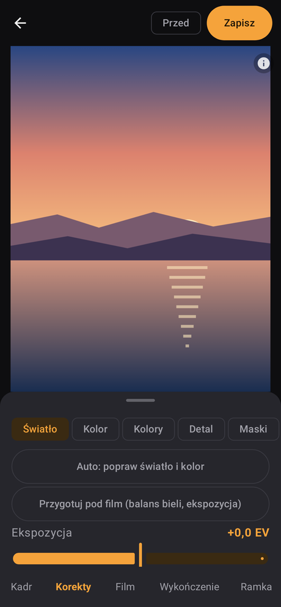
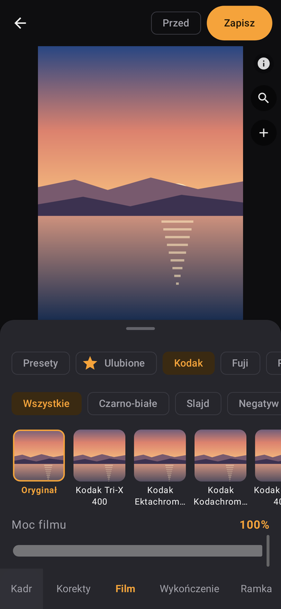
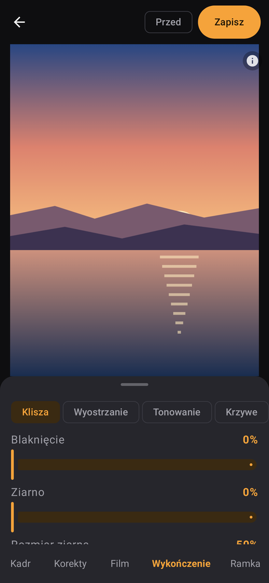
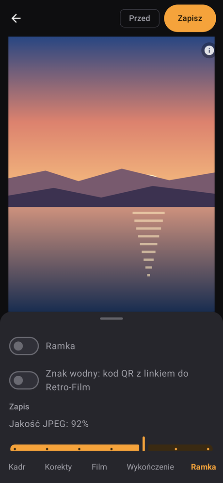
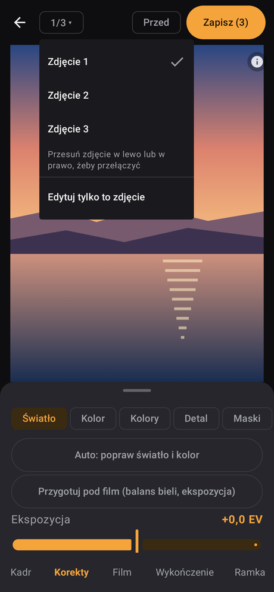
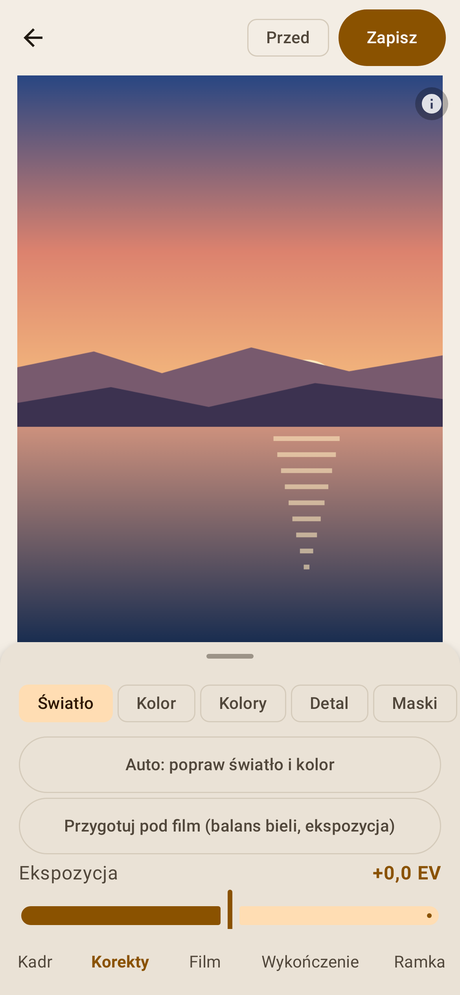

# Retro-Film

Aplikacja na Androida, która nadaje zdjęciom z telefonu wygląd klasycznych filmów analogowych. Działa offline, bez
konta, a przy zapisie usuwa lokalizację GPS ze zdjęcia. Interfejs jest po polsku.

<table>
  <tr>
    <td align="center"><br><sub>Korekty</sub></td>
    <td align="center"><br><sub>Film</sub></td>
    <td align="center"><br><sub>Wykończenie</sub></td>
  </tr>
  <tr>
    <td align="center"><br><sub>Ramka i zapis</sub></td>
    <td align="center"><br><sub>Seria zdjęć</sub></td>
    <td align="center"><br><sub>Jasny motyw</sub></td>
  </tr>
</table>

<sub>Zrzuty pokazują układ edytora na narysowanej scenie, bez efektu wybranego filmu.</sub>

## Co potrafi

- **Filmy:** 10 filmów startowych w aplikacji i do 260 w pakietach do pobrania (negatywy, slajdy, czarno-białe), z
  regulacją mocy filmu, kategoriami, ulubionymi i miniaturami na Twoim zdjęciu.
- **Korekty przed filmem:** światło (ekspozycja, kontrast, światła, cienie, biele, czernie, tekstura), kolor (balans
  bieli, nasycenie, HSL), detal (wyrazistość, wyostrzanie z ochroną włosów i oczu, dehaze, odszumianie), maski liniowa i
  radialna, krzywe oraz przyciski „Auto” i „Przygotuj pod film”.
- **Wykończenie po filmie:** klisza (blaknięcie, ziarno, winieta), tonowanie, krzywe, wyostrzanie.
- **Kadr:** przycinanie gestem, obrót, perspektywa.
- **Ramka:** z odręcznym podpisem (kilka czcionek, kolor, wielkość) i opcjonalnym znakiem wodnym z kodem QR.
- **Seria zdjęć:** wiele zdjęć naraz, przełączanie przesunięciem palca, edycja każdego zdjęcia osobno (film, korekty,
  kadr, ramka) albo ustawienie wspólne dla wszystkich, zapis całej serii jednym przyciskiem.
- **Zapis:** JPEG (jakość i rozmiar do wyboru), lokalizacja GPS usuwana, zdjęcia Display P3 poprawnie sprowadzane do sRGB.
- **Wygoda:** ciemny i jasny motyw, wsparcie TalkBack, duże cele dotykowe, ostrzeżenie przed utratą niezapisanych zmian.

Algorytmy obrazu (światła, wyostrzanie, ziarno, dehaze i inne) są liczone w całości na telefonie, bez sieci
neuronowych, z naciskiem na to, żeby wydobyć maksimum z JPEG i nie niszczyć detalu. Opis metod i stan wdrożenia:
[docs/PRZEGLAD-ALGORYTMOW.md](docs/PRZEGLAD-ALGORYTMOW.md).

## Instalacja

Wymaga Androida 8.0 lub nowszego. Podpisane pliki APK są w [Releases](https://github.com/Jack4B/Retro-Film/releases/latest). Najwygodniej przez
[Obtainium](https://github.com/ImranR98/Obtainium): dodaj adres `https://github.com/Jack4B/Retro-Film` i aplikacja sama
będzie sprawdzać nowe wersje.

## Prywatność

Zdjęcia są przetwarzane wyłącznie na telefonie. Sieć służy tylko do opcjonalnego pobierania pakietów filmów. Aplikacja
nie wymaga konta, a z zapisanych zdjęć usuwa lokalizację GPS.

## Dla programistów

Kotlin, Jetpack Compose, moduły `app`, `core/*` i `feature/*`. Zmiany idą przez gałąź i pull request do `main`;
CI (GitHub Actions) uruchamia ktlint, detekt, testy (w tym zrzuty Roborazzi) i porównanie na zdjęciach testowych.

```
./gradlew assembleDebug          # kompilacja
./gradlew testDebugUnitTest      # testy jednostkowe
```

Wydania powstają z taga `vX.Y.Z` przez workflow `release.yml`. Zasady pracy: [AGENTS.md](AGENTS.md),
[CONTRIBUTING.md](CONTRIBUTING.md).

## Dokumentacja

- [Architektura](docs/ARCHITEKTURA.md) · [Ekrany](docs/EKRANY.md) · [Decyzje](docs/DECYZJE.md) · [Plan](docs/PLAN.md) ·
  [Handoff](docs/HANDOFF.md)
- [Algorytmy](docs/ALGORYTMY.md) · [Przegląd algorytmów](docs/PRZEGLAD-ALGORYTMOW.md) ·
  [Stan algorytmów](docs/STAN-ALGORYTMOW.md) · [Plan: Dodge & Burn](docs/PLAN-DODGE-BURN.md)
- [Specyfikacja ramki](docs/RAMKA-SPEC.md) · [LUT-y](docs/LUTS.md) · [Narzędzia sesji](docs/NARZEDZIA-CLAUDE.md)

## Licencje

Kod: MIT. Katalog `luts/` i filmy w aplikacji: CC BY-SA 4.0 ([RawTherapee Film Simulation
Collection](https://rawpedia.rawtherapee.com/Film_Simulation): Pat David, Pavlov Dmitry, Michael Ezra). Zob.
[LICENSE](LICENSE) i [THIRD_PARTY.md](THIRD_PARTY.md). Retro-Film jest projektem niezależnym, niepowiązanym z
producentami filmów; nazwy filmów pochodzą z paczki i służą wyłącznie opisowi.

Projekt rozwija Jack4B z zespołem botów (role i zasady w [AGENTS.md](AGENTS.md)).
